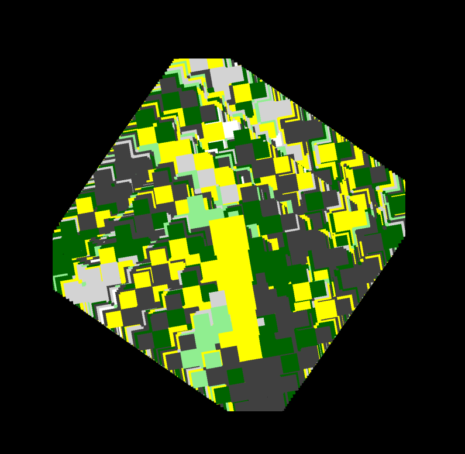

# World Generation With Fractals
A program that creates unique maps with squares which can then be used to create biomes for a game.

## Features
- Single command 
- random maps with custom controls
- tui interface
- notes for learning resource

## Fractals
A fractal is a complex geometrical shape that contains detailed structure at arbitrarily 
small scales and repeats similair pattern across different levels of magnification. Most fractals are dictated by either an equation or a repeating pattern of shapes, this specefic one is mainly just squares and each iteration it decreases by a proportion.

## How to use
1. Go to releases and download the most recent release

2. Make the file exucatable by running this command the second part is the file path so 
ensure it is relative
    chmod +x WGWF

3. Download Requirements file using pip 

## Final Notes
Read the notes and also understand the code is nicer to use if you clone the repo for now the setting on the generation are hard coded, if you clone the repo you change change it. 
I also plan on picking this up again and expanding it.
